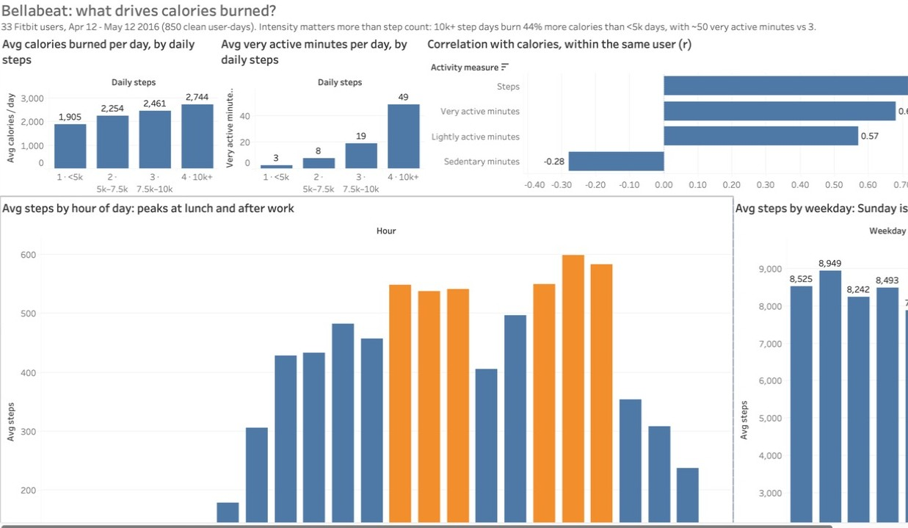
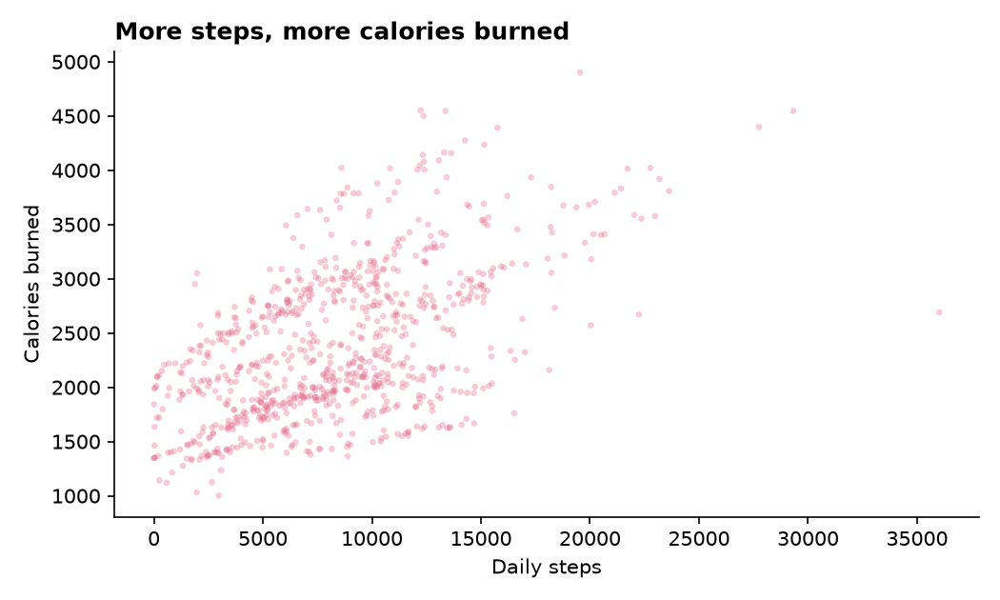
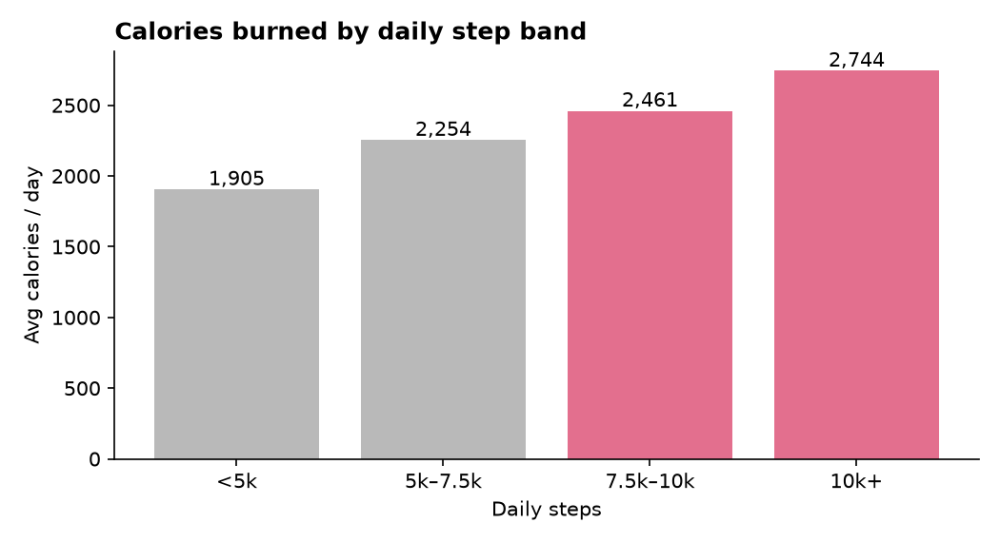
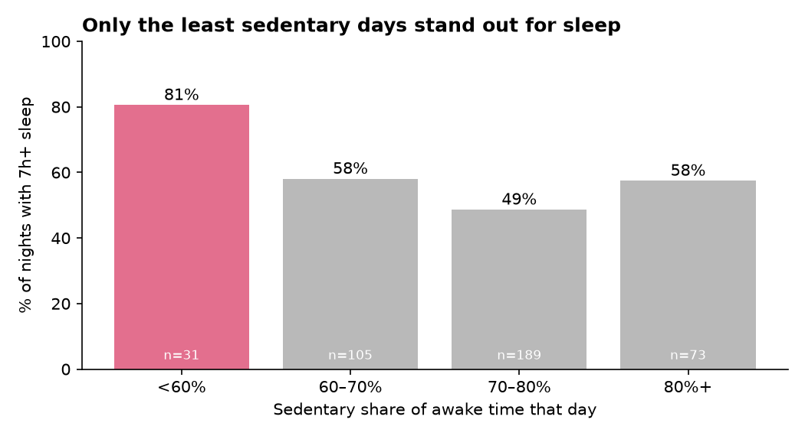
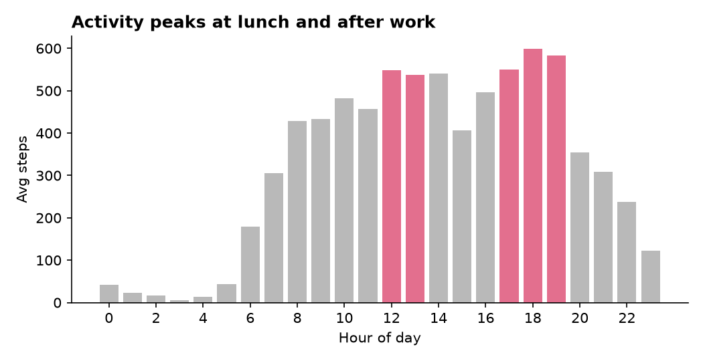
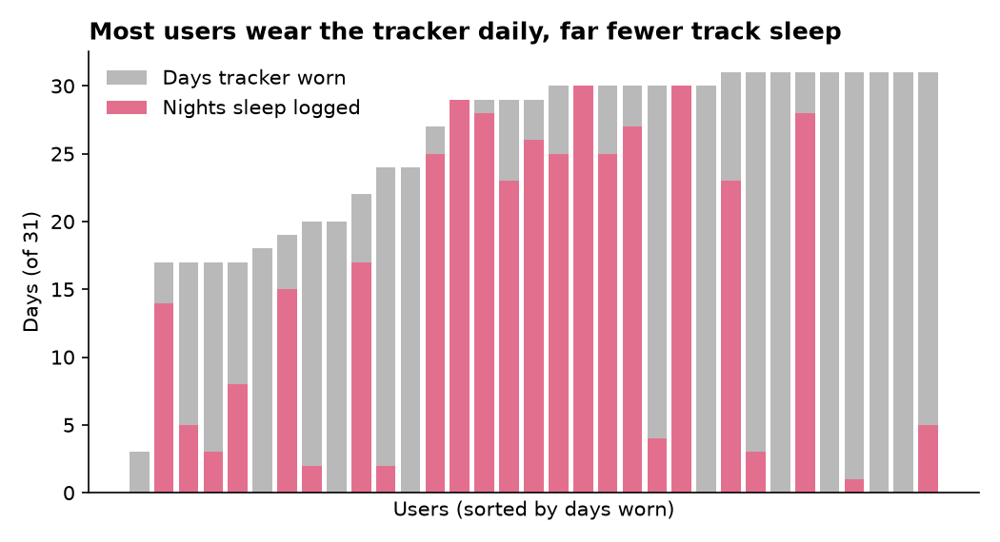

# Bellabeat Consumer Behavior Analytics

**SQL (DuckDB) · Python (pandas, matplotlib) · Tableau · Data cleaning & validation · Product recommendations**

📊 **[Interactive Tableau dashboards](https://public.tableau.com/app/profile/xuerui.zhang4116/viz/BellabeatConsumerBehaviorAnalytics/1ActivityandCalories)**

*Google Data Analytics Certificate capstone: "How can a wellness technology company play it smart?"*

Bellabeat makes wellness wearables for women (the Leaf tracker, the Time watch, the Bellabeat app). The
marketing team asked: **how do people actually use smart fitness devices, and what should Bellabeat do with that?**
I answered it with one month of Fitbit data from 33 users: I cleaned and joined their activity and sleep logs in SQL,
tested how activity intensity and sedentary time relate to calories burned and to sleep, and turned the usage patterns
into three product and engagement recommendations.

## TL;DR

| Question | Answer |
|---|---|
| **What drives calories burned?** | Intensity, not just step count. Within the same person, steps track calories closely (r = 0.82). Across people, **very active minutes** are the strongest single measure (r = 0.62, vs 0.15 for light activity). Days with 10k+ steps burned **44% more calories** than days under 5k (2,744 vs 1,905), and had 48 very active minutes vs 3. |
| **Does sitting more hurt sleep?** | **Less than it first looks.** The naive correlation is strong (r = −0.68), but it is mostly a measurement artifact: on 76% of sleep-logged days, awake tracked time + time in bed ≈ 24 h, so more time in bed automatically means fewer sedentary minutes. Using the sedentary *share* of awake time, the link is weak (r = −0.20). Only the least sedentary days (<60% of awake time) stand out: **81% reached 7 h+ sleep vs 49–58%** for the rest. |
| **How do people use their devices?** | 21 of 33 users wore the tracker on 25+ of 31 days, but **9 never logged sleep** and only 14 logged it on half the nights or more. Only **55% of logged nights reached 7 h**. Activity peaks at **12–2 pm and 5–7 pm**; Sunday is the least active day. |

## Recommendations for Bellabeat

1. **Make "active minutes" the headline goal, not only steps.** Intense minutes explain calories best, and a 10k-step
   day averages ~50 very active minutes, vs 3 on a sub-5k day. The Bellabeat app should show progress toward a daily active-minutes
   target and celebrate intensity, not only step totals.
2. **Turn sleep into a feature people actually use.** More than a quarter of users (9 of 33) never tracked sleep and almost half of the nights
   that were tracked fell short of 7 h. The Leaf is jewelry-style and comfortable to wear overnight. Market it that way,
   add a bedtime reminder and a weekly sleep summary, and run an onboarding prompt for users who have not logged sleep
   in their first week.
3. **Time nudges to when people move, and to when they don't.** Send "get moving" prompts in the 3 pm dip and on Sundays,
   and use the lunch and after-work peaks for challenges and streaks. This keeps engagement high without adding
   notification noise.

## Tableau dashboards

**Live version: [Tableau Public](https://public.tableau.com/app/profile/xuerui.zhang4116/viz/BellabeatConsumerBehaviorAnalytics/1ActivityandCalories)**. Two dashboards:

1. **Activity and Calories:** calories and very active minutes by step band, what correlates with calories within the
   same user, and steps by hour and weekday.
2. **Sleep and Engagement:** the share of nights with 7 h+ sleep by sedentary share of awake time, and how consistently
   users wore the tracker and logged sleep.



The workbook [`tableau/bellabeat_dashboard.twbx`](tableau/bellabeat_dashboard.twbx) is generated by
`python src/build_tableau.py`. That script rebuilds the clean table with the same SQL as the analysis, then exports
tidy CSVs and Hyper extracts (which Tableau Public requires) into `tableau/Data/`.

## Python charts

| | |
|---|---|
|  |  |
|  |  |



## Process (Ask → Prepare → Process → Analyze → Share → Act)

**Ask.** Business task: find trends in smart-device usage and apply them to one Bellabeat product and its marketing.
Stakeholders: Urška Sršen (co-founder & CCO), Sando Mur (co-founder), and the marketing analytics team.

**Prepare.** [FitBit Fitness Tracker Data](https://zenodo.org/records/53894) (Furberg, Brinton & Keating, 2016, CC BY 4.0),
the dataset the case study points to (also on Kaggle). 33 Amazon Mechanical Turk volunteers, Apr 12 – May 12 2016.
Limitations, which matter for how far the findings go:

- Small sample (33 users; only 24 logged sleep and 8 logged weight), no age, gender or location. Bellabeat's customers
  are women, and this sample may not be.
- Self-selected volunteers, 2016 data, one month only. Treat results as directional and validate them with Bellabeat's own app data.

**Process** ([`sql/01_data_quality.sql`](sql/01_data_quality.sql), [`sql/02_clean_and_join.sql`](sql/02_clean_and_join.sql)).

- Checked coverage, duplicates and impossible values for each table.
- Removed 3 duplicate sleep rows.
- Removed 90 "not worn" days: 0 steps, or under 10 hours of tracked minutes (77 days had 0 steps; 79 had a full 1,440 sedentary minutes, which means the device sat on a desk).
- Joined activity and sleep by user and date, then checked the join added no rows: **850 clean user-days for 33 users, 398 with sleep for 24 users.**

**Analyze** ([`sql/03`](sql/03_activity_vs_calories.sql), [`sql/04`](sql/04_sedentary_vs_sleep.sql), [`sql/05`](sql/05_usage_patterns.sql)).

- Correlations were computed two ways:
  - **pooled** across everyone;
  - **within-user**, where each person's own average is subtracted, so differences in body size between people do not dominate.
- Days were also grouped into bands for easy reading.
- The sleep analysis includes a check for the "time in bed vs. tracked minutes" artifact described above.

**Share.** Two Tableau dashboards ([Tableau Public](https://public.tableau.com/app/profile/xuerui.zhang4116/viz/BellabeatConsumerBehaviorAnalytics/1ActivityandCalories)), charts in [`images/`](images/), and every query output in [`results.md`](results.md) and [`data/processed/`](data/processed/).

**Act.** See the three recommendations above.

## Repo structure

```
data/raw/         4 source CSVs from the public Fitbit dataset (daily activity, sleep, hourly steps, weight)
data/processed/   one CSV per query result
sql/              01 data quality → 02 clean & join → 03 calories → 04 sleep → 05 usage patterns
src/run_analysis.py   loads the CSVs into DuckDB, runs every SQL file in order, writes results + charts
src/build_tableau.py  builds the Tableau workbook (tableau/bellabeat_dashboard.twbx) from the same SQL
tableau/          Tableau workbook, tidy CSVs and Hyper extracts
results.md        all query outputs in one page
images/           charts used above
```

## Reproduce

```bash
pip install -r requirements.txt
python src/run_analysis.py
python src/build_tableau.py   # optional: rebuild the Tableau workbook
```

## About

By **Xuerui Zhang**, as part of the Google Data Analytics Professional Certificate. Bellabeat is a real company used
in the course's case study. This is a course project and is not affiliated with Bellabeat.
